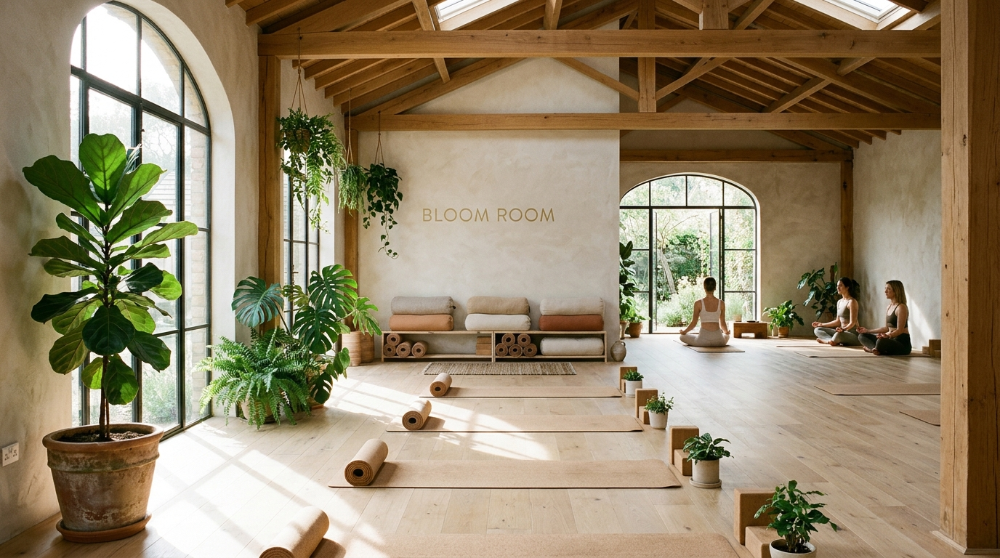

# Bloom Room Yoga — 6-Week Spring Renewal Landing Page

A responsive, high-converting landing page crafted for **Bloom Room Yoga & Sanctuary** promoting their upcoming **6-Week Spring Renewal Program** (*April 6 – May 17, 2026*).



---

## ✨ Features & Architecture

1. **Brand Aesthetic & Typography**:
   - Custom organic color palette: warm terracotta (`#C87D55`), calming eucalyptus sage (`#4A6054`), soft meadow (`#8E9B82`), and light warm linen (`#FAF7F2`).
   - Editorial headings with *Cormorant Garamond* paired with high-legibility geometric sans-serif *Plus Jakarta Sans*.
   - Original high-resolution photography generated specifically for the sanctuary, movement postures, and botanical tea ceremonies.

2. **Conversion & Engagement Engines**:
   - **Live Countdown Timer**: Real-time ticker counting down to the early-bird registration deadline.
   - **Interactive 6-Week Curriculum**: Dynamic tabbed viewer showcasing each week's elemental arc (*Earth/Grounding*, *Water/Detox*, *Fire/Vitality*, *Air/Heart Opening*, *Space/Sound Healing*, *Integration/Full Bloom*), including somatic movement focuses, breathwork practices, weekly take-home gifts, and journaling prompts.
   - **Interactive Spring Vitality Quiz**: A 3-question self-assessment tool recommending tailored cohort rhythms, botanical adaptogens, and program tiers based on current physical/mental states.
   - **Filterable Weekly Schedule**: Dynamic filtering across *Morning Dawn Flow* (7:00 AM), *Midday Mobility* (12:00 PM), *Twilight Yin* (6:30 PM), and *Weekend Immersions*.
   - **Tuition & Payment Toggle**: Seamless switch between single upfront payment (saving $50) and bi-weekly installment plans.
   - **Multi-Step Reservation Modal**: Interactive booking workflow capturing participant preferences, injuries/sensitivities, and generating downloadable `.ics` calendar passes.
   - **FAQ Accordion & Social Proof**: Expandable question panels and student testimonial transformations.

---

## 📁 Project Structure

```text
├── assets/
│   ├── hero.jpg             # High-res interior sanctuary hero photography
│   ├── instructor.jpg       # Lead instructor somatic alignment pose
│   └── ritual.jpg           # Spring tea, quartz singing bowl & gratitude journal
├── index.html               # Semantic HTML5 landing page layout
├── styles.css               # Design tokens, typography, glassmorphism & responsive CSS
├── script.js                # Interactive logic (quiz, curriculum tabs, timer, modal)
└── README.md                # Project documentation
```

---

## 🚀 Running Locally

To run the local development server:

```bash
python3 -m http.server 8080
```

Open `http://localhost:8080` in your browser.
